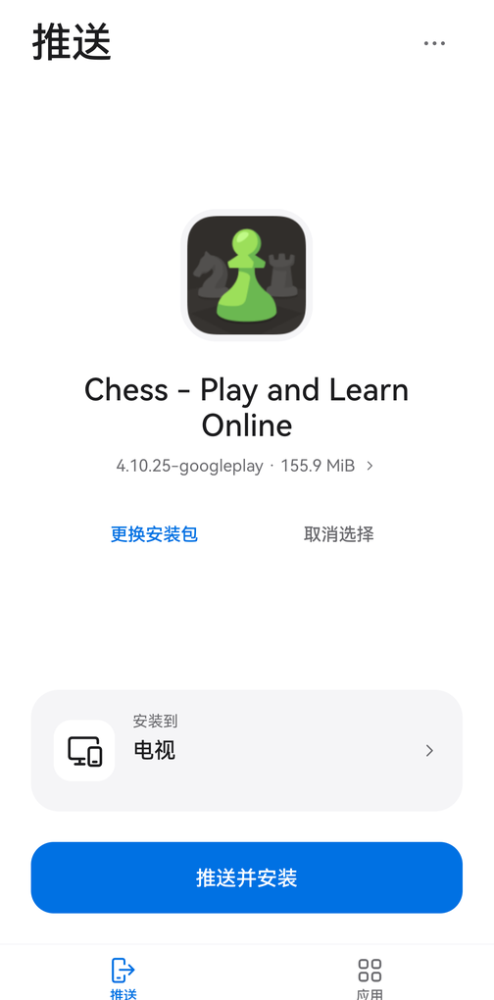
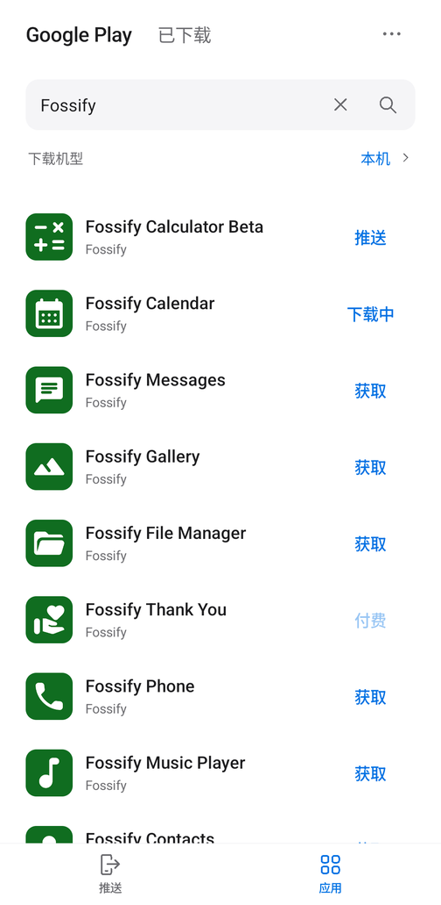
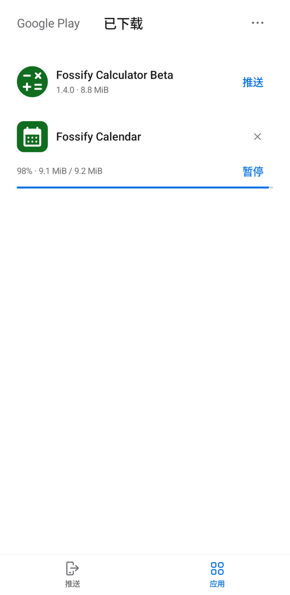
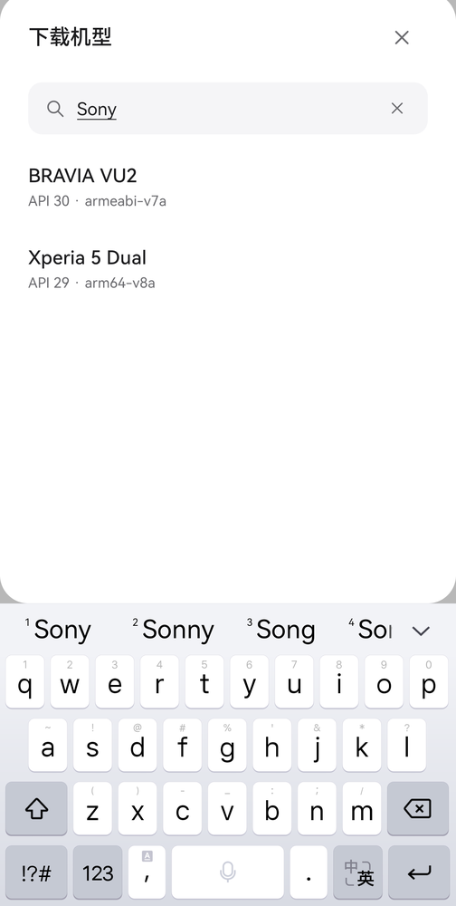

<div align="center">
  
  <h1>APK Push</h1>
  <p><strong>Find an Android app. Download it. Send it from your phone.</strong></p>
  <p>Install APKs on your TV, streaming box, tablet, or another phone over local-network ADB.</p>
  <p>
    
    
    <a href="LICENSE"></a>
  </p>
  <p><a href="README.md">简体中文</a> · <strong>English</strong></p>
  <p><a href="#quick-start">Quick start</a> · <a href="#build-from-source">Build</a> · <a href="#faq">FAQ</a> · <a href="https://github.com/VonSdite/APKPush/issues">Report an issue</a></p>
</div>

---

APK Push combines **device installation** and **Google Play downloads** in two focused tabs. Choose a local APK or download an app, select an Android device on your network, and install it. Neither device needs root or a companion receiver app. The target must expose a working network ADB service.

## Screenshots

<table>
  <tr>
    <td align="center"><strong>Send an app</strong></td>
    <td align="center"><strong>Search Google Play</strong></td>
    <td align="center"><strong>Manage downloads</strong></td>
    <td align="center"><strong>Find a device profile</strong></td>
  </tr>
  <tr>
    <td></td>
    <td></td>
    <td></td>
    <td></td>
  </tr>
</table>

Actual phone and emulator screenshots from versions 1.10.0–1.12.1, with the device address and system status bars removed. **The app UI is currently in Simplified Chinese.**

## Features

| Feature | What it does |
| --- | --- |
| **Install from your phone** | Select a local APK or a downloaded app, follow transfer progress, verify the installed version, and launch the app on the target. |
| **Discover local devices** | Combine mDNS, port probes, and saved endpoints; enter an IP address and port manually when needed. |
| **Download from Google Play** | Search free apps, retrieve standalone or split APKs for a device profile, and check downloaded apps for updates. |
| **Background download queue** | Run up to 3 downloads concurrently, with pause, resume, cancel, manual retry, and range-based resumption when supported. |
| **Accessible files** | Save completed packages to `Download/APK Push/`; swipe to delete or long-press to select multiple downloads. |
| **Install locally** | Hand standalone and split packages from the library to Android's system installer for user confirmation. |
| **Searchable device profiles** | Use your phone's configuration or 23 bundled profiles; filter by brand, model, API level, Android version, and ABI. |
| **Less copying** | Stream readable standalone APKs through retained file descriptors and verify downloaded files during transfer; prepare split packages in temporary storage. |

## Quick start

### 1. Prepare the app and target

Download the signed **release APK** and SHA-256 checksum from [GitHub Releases](https://github.com/VonSdite/APKPush/releases/latest), or [build from source](#build-from-source). The current version is **1.12.1** and requires **Android 10 / API 29 or later**.

Connect both devices to a mutually reachable LAN. Enable **network ADB / network debugging** in the target's developer settings. The target can use Wi-Fi or Ethernet.

> Traditional TCP ADB is supported. Android's pairing-code wireless debugging uses a different protocol: APK Push can discover those services, but pairing and TLS installation are not implemented.

### 2. Choose an app

- **Local APK:** open the **推送** (Push) tab, then **选择安装包 → 从文件选择** (Choose package → From files). Sharing an APK from a file manager also works.
- **Google Play:** open **应用** (Apps), choose a download profile, search, and tap **获取** (Get). Tap **推送** (Push) after the download finishes.

Use **本机** (This device) for local installation. For another device, choose a profile with a suitable Android version, ABI, and device type. A profile does not guarantee compatibility with every device from the same manufacturer.

### 3. Send and install

Tap **选择设备** (Choose device), select a discovered or saved endpoint, or enter its address manually. Confirm the app and destination, then tap **推送并安装** (Push and install). Accept the `APKPush@android` debugging authorization on the target when connecting for the first time.

Keep APK Push in the foreground until transfer, installation, and version verification finish. **Each push handles one app and one target.** All split APKs belonging to that app are installed together.

## Support boundaries

| Area | Current scope |
| --- | --- |
| ADB | Traditional TCP ADB and RSA authorization. No pairing-code or TLS installation. |
| Discovery | mDNS, saved ports, and port `5555` within the actual IPv4 subnet, bounded to `/22`. Unknown custom ports without advertisements need manual entry. |
| Imports | Standalone `.apk` files; Play split packages through the download library. External `.apks`, `.xapk`, and `.apkm` imports are not supported. |
| Google Play | Free apps available anonymously. Account, region, and device restrictions apply. No automatic retrieval of OBB, Play Asset Delivery, or dependent shared libraries. |
| Recovery | Interrupted tasks are retained and wait for a manual resume or retry. No automatic download retries. |
| Background work | Downloads can continue in the background or with the screen locked. Device pushing requires the foreground. |
| File size | Up to 2 GiB per import or download. Split packages need additional preparation space. |

Traditional TCP ADB is not TLS-encrypted; use it on a trusted network. Successful installation does not guarantee TV remote-control support, a suitable layout, or the availability of Google services.

## FAQ

<details>
<summary><strong>Why is my device missing even though USB debugging is enabled?</strong></summary>

USB debugging does not open a network ADB port. A device that only supports USB ADB needs `adb tcpip 5555` over an existing USB connection first; some devices need this again after reboot. APK Push cannot remotely enable a service that is not already reachable.

Check that the network allows devices to reach each other and does not enable guest isolation. Try the target's actual IP address and connection port manually. A pairing port is not a traditional ADB connection port.

</details>

<details>
<summary><strong>Where do the APKs come from? Is the API official or unlimited?</strong></summary>

The app uses [Aurora gplayapi 4.0.0](https://gitlab.com/AuroraOSS/gplayapi), a third-party open-source client library. Search uses Google Play web services, and anonymous downloads obtain file URLs from Google Play services. APK Push does not use third-party APK mirrors.

gplayapi is not an official Google open-source download SDK. Google may rate-limit requests, require an account, or restrict an app by region or device. Service changes can break the integration. There is no unlimited-request guarantee, and a search result is not a promise that an app can be downloaded.

Downloads use HTTPS with length and hash verification. This is not independent verification of the developer's signing identity. The library is a Gradle dependency, not a Git submodule.

</details>

<details>
<summary><strong>Does the profile list cover every device?</strong></summary>

No. It combines live properties from your phone with 23 bundled gplayapi configurations. Profiles include system, ABI, display, feature, and shared-library information.

For example, BRAVIA VU2 describes an API 30, 32-bit ARM television; it does not represent every Sony TV. APK Push checks minimum SDK and ABI before installation, but full runtime compatibility still depends on the target.

</details>

<details>
<summary><strong>How do I install a downloaded .apks file on this phone?</strong></summary>

A `.apks` archive contains the split APKs for one app. Open its details in **已下载** (Downloaded), choose **安装到本机** (Install on this device), and confirm in Android's installer. You may need to allow APK Push to install apps first.

Completed files live in `Download/APK Push/` and remain after uninstalling APK Push. The library index is app data: reinstalling APK Push does not automatically re-import those files.

</details>

Detailed behavior is documented in the [usage guide](docs/usage.md) (Chinese).

## Build from source

Requirements: **JDK 17 or 21**, **Android SDK Platform 34**, and **Build Tools 34.0.0**. Windows builds use **PowerShell 7**. Gradle Wrapper 8.10.2, AGP 8.7.3, and Kotlin 2.3.21 are pinned in the project.

```sh
git clone https://github.com/VonSdite/APKPush.git
cd APKPush
```

**Windows / PowerShell 7**

```powershell
$env:JAVA_HOME = 'D:/path/to/jdk-21'
$env:ANDROID_HOME = 'D:/path/to/android-sdk'
pwsh.exe -File scripts/build.ps1
```

**Linux / WSL**

```sh
export JAVA_HOME=/path/to/jdk-21
export ANDROID_HOME=/path/to/android-sdk
sh scripts/build.sh
```

The scripts run unit tests, Android Lint, and APK packaging. The output is `artifacts/APK-Push-1.12.1-debug.apk`. The first build downloads dependencies; once cached, pass the desired tasks followed by `--offline`.

Caches, intermediate files, and the development signing key stay under `tmp/` and are excluded from Git. Keep `tmp/keys/debug.keystore` to preserve the signing identity across local builds. Production distribution needs a stable release signing configuration. The application ID is `dev.tvapkpush`.

See the [release guide](docs/releasing.md) (Chinese) for production signing. Release and debug builds use different signing keys and cannot replace one another directly; uninstalling the debug build removes its private app data.

## Development and verification

APK Push uses Kotlin and native Android Views. The source is organized into `adb/` for protocol and transport, `core/` for installation, `discovery/` for LAN discovery, `data/` for imports and persistence, `play/` for search and downloads, and `install/` for local installation.

Version 1.12.1 passed **89 JVM tests** and Android Lint with **0 errors and 2 known warnings**. Relevant interactions were checked on an API 31 phone and an API 37 emulator. Full installation from a physical phone to a physical TV remains unverified; these results are not a universal compatibility guarantee.

- [Architecture and ADB design](docs/adb-design.md) (Chinese)
- [Validation record and limitations](docs/validation.md) (Chinese)
- [Contributing](CONTRIBUTING.md)

Reproducible bug reports, device compatibility feedback, documentation improvements, and pull requests are welcome. If APK Push is useful to you, consider giving it a **Star** to help others discover it.

## Credits and license

Built with [Aurora OSS](https://gitlab.com/AuroraOSS/gplayapi), Kotlin, OkHttp, AndroidX, and Protocol Buffers. See the [third-party notices](app/src/main/assets/NOTICE.txt). App names and icons shown in screenshots belong to their respective owners.

APK Push is licensed under **[GPL-3.0-or-later](LICENSE)**. APK distribution must comply with GPLv3 and provide the corresponding source. APK Push is not affiliated with Google.
