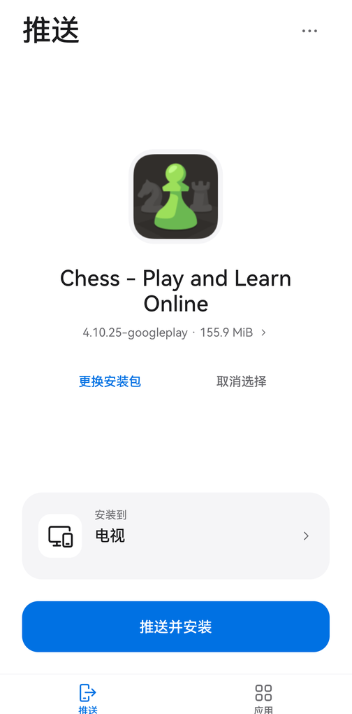
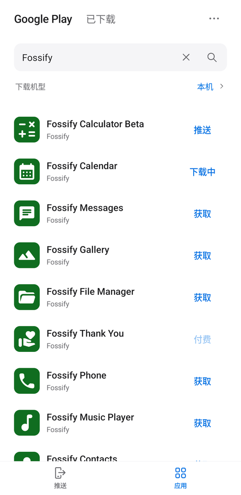
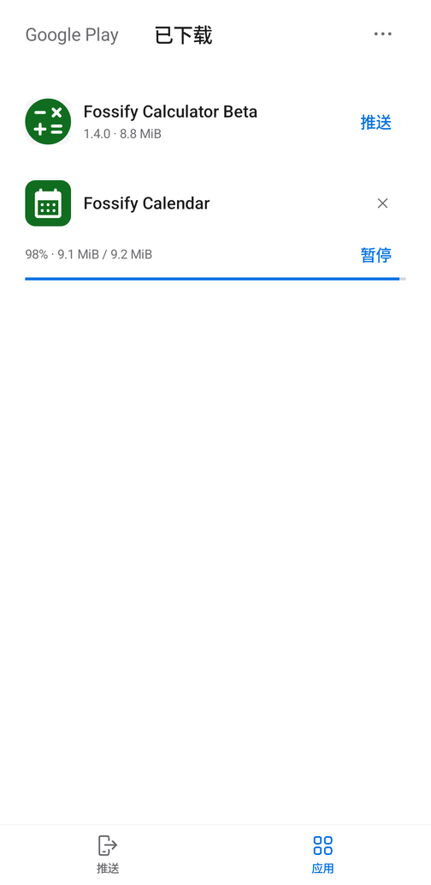
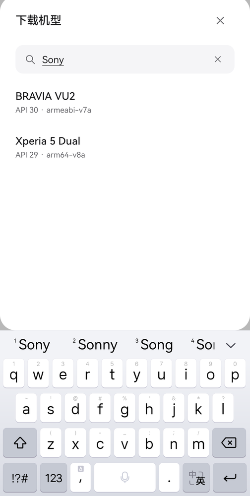

<div align="center">
  
  <h1>APK Push</h1>
  <p><strong>从手机出发，搜索、下载并推送 Android 应用。</strong></p>
  <p>通过局域网 ADB，将 APK 安装到你的电视、盒子、平板或另一部手机。</p>
  <p>
    
    
    <a href="LICENSE"></a>
  </p>
  <p><strong>简体中文</strong> · <a href="README.en.md">English</a></p>
  <p><a href="#快速上手">快速上手</a> · <a href="#从源码构建">源码构建</a> · <a href="#常见问题">常见问题</a> · <a href="https://github.com/VonSdite/APKPush/issues">反馈问题</a></p>
</div>

---

APK Push 把 **APK 推送**和 **Google Play 下载**放在两个清晰的页面里。你可以选择本地安装包，也可以先下载应用，再选择局域网中的 Android 设备安装。无需 Root，目标设备无需安装配套接收应用，但需要开启可用的网络 ADB。

## 界面预览

<table>
  <tr>
    <td align="center"><strong>选择应用并推送</strong></td>
    <td align="center"><strong>搜索 Google Play</strong></td>
    <td align="center"><strong>下载与任务管理</strong></td>
    <td align="center"><strong>搜索下载机型</strong></td>
  </tr>
  <tr>
    <td></td>
    <td></td>
    <td></td>
    <td></td>
  </tr>
</table>

截图来自手机与模拟器的实际运行，覆盖 1.10.0–1.12.1；设备地址和系统状态栏已隐藏。应用当前提供中文界面。

## 能做什么

| 功能 | 说明 |
| --- | --- |
| **手机推送安装** | 导入本地 APK，或从下载库选择应用；显示传输进度，安装后核对版本，支持在目标设备打开应用。 |
| **自动发现设备** | 结合 mDNS、局域网端口探测与已保存地址搜索设备，也支持手动输入 IP 和端口。 |
| **Google Play 下载** | 搜索免费应用，按下载机型获取独立 APK 或整套拆分包，并检查已下载应用的更新。 |
| **后台下载队列** | 最多 3 项并发，其余排队；支持暂停、继续、取消和手动重试，服务器支持时可断点续传。 |
| **文件管理器可见** | 完整文件保存到公共 `Download/APK Push/`；下载库支持左滑删除和长按多选批量删除。 |
| **本机安装** | 从下载详情调用系统安装器，支持下载库中的独立 APK 和拆分包，由用户确认安装。 |
| **下载机型搜索** | 本机配置加 23 个内置配置，可按品牌、型号、API、Android 版本和架构过滤。 |
| **减少重复读取** | 可直接读取的独立 APK 使用文件句柄推送，下载文件在传输时校验；拆分包保留必要的解包缓存。 |

## 快速上手

### 1. 准备应用和设备

从 [GitHub Releases](https://github.com/VonSdite/APKPush/releases/latest) 下载签名的 **release APK** 与 SHA-256 校验文件，或按[源码构建](#从源码构建)自行打包。当前版本为 **1.12.1**。发起推送的手机需要 **Android 10 / API 29 或更高版本**。

将手机与目标设备接入同一可互访局域网，在目标设备的开发者选项中开启 **网络 ADB / 网络调试**。目标设备可以通过 Wi-Fi 或网线联网。

> 当前支持传统 TCP ADB。Android 的“无线调试配对码”连接使用另一套协议，本版本可以发现这类服务，但尚不支持配对及 TLS 安装。

### 2. 选择安装包

- 已有 APK：在“推送”页点击 **选择安装包 → 从文件选择**，也可从文件管理器分享 APK。
- 从 Google Play 获取：在“应用”页选择下载机型，搜索应用并点击 **获取**；下载完成后点击 **推送**。

给当前手机安装时选择“本机”配置；给其他设备安装时选择接近目标设备的系统版本、架构及类型。机型配置不保证应用能在所有同品牌设备上运行。

### 3. 推送并安装

点击 **选择设备**，从发现结果或已保存设备中选择目标，也可手动填写地址。核对应用和目标后点击 **推送并安装**，首次连接时在目标设备允许 `APKPush@android` 的调试授权。

推送期间保持 APK Push 在前台，等待传输、安装与版本核验完成。**每次选择一个应用、一个目标设备**；一个应用的多个拆分 APK 会作为一组安装。

## 使用边界

| 项目 | 当前支持范围 |
| --- | --- |
| ADB 连接 | 传统 TCP ADB、首次 RSA 授权；配对码与 TLS 安装暂不支持。 |
| 自动发现 | mDNS、已保存设备的实际端口、实际 IPv4 子网内最多 `/22` 范围的 `5555` 端口。未知且未广播的自定义端口需手动添加。 |
| 文件导入 | 本地文件入口接受独立 `.apk`；下载库支持 Play 拆分包。外部 `.apks` / `.xapk` / `.apkm` 导入暂不支持。 |
| Google Play | 支持可匿名获取的免费应用；付费、账号授权、地区和设备限制仍然适用。OBB、Play Asset Delivery 与配套共享库暂不支持自动获取。 |
| 下载恢复 | 暂停、断网或异常退出后保留任务；由用户点击继续或重试，不自动重试。 |
| 后台运行 | 下载支持后台与锁屏运行；向设备推送安装需要前台运行。 |
| 文件大小 | 单次导入或下载上限为 2 GiB，准备拆分包时需预留缓存空间。 |

传统 TCP ADB 没有 TLS 加密，请在可信局域网中使用。安装成功也不代表应用适配电视遥控器、屏幕或 Google 服务环境。

## 常见问题

<details>
<summary><strong>开启了 USB 调试，为什么找不到设备？</strong></summary>

USB 调试不代表网络 ADB 端口已经开放。只有 USB ADB 的设备，需要先通过已有 USB 连接执行 `adb tcpip 5555`；部分设备重启后需要重新开启。APK Push 无法远程开启尚未开放的 ADB 服务。

确认手机与设备之间可以互访，路由器没有开启访客隔离。搜索仍无结果时，可手动输入设备 IP 和实际连接端口。配对码端口不能作为传统 ADB 端口使用。

</details>

<details>
<summary><strong>APK 来自 Google，还是第三方镜像站？接口能无限使用吗？</strong></summary>

搜索和下载通过第三方开源库 [Aurora gplayapi 4.0.0](https://gitlab.com/AuroraOSS/gplayapi) 实现。搜索访问 Google Play 网页服务，匿名下载从 Google Play 服务获取文件地址；项目不使用第三方 APK 镜像源。

gplayapi 不是 Google 官方开源下载 SDK。Google 服务可能限流、要求账号授权或限制应用可用性，接口变化也可能影响功能，没有无限请求额度承诺。搜索到应用不代表当前机型和地区一定能下载。

文件通过 HTTPS 下载并校验长度与哈希；这不等同于独立验证开发者签名。gplayapi 通过 Gradle 依赖引入，不是 Git submodule。

</details>

<details>
<summary><strong>机型列表是全的吗？索尼电视该选哪个？</strong></summary>

列表由当前手机的实时配置和 gplayapi 内置的 23 个配置组成，不是全部 Android 设备目录。参数包括系统、架构、屏幕、功能和共享库等。

BRAVIA VU2 是 API 30、32 位 ARM 的电视配置，不代表所有索尼电视。应以目标设备的实际系统和 ABI 为准；推送前会检查 APK 的最低系统要求和架构，但不能保证运行层面的全部兼容性。

</details>

<details>
<summary><strong>下载的是 .apks，怎么在本机安装？</strong></summary>

`.apks` 包含同一应用的多个拆分 APK。在“已下载”中打开应用详情，点击 **安装到本机**，按系统提示确认即可。首次使用需允许 APK Push 安装应用。

完整文件位于 `Download/APK Push/`，卸载 APK Push 后仍保留；下载库索引随应用数据删除，重新安装后不会自动导入这些遗留文件。

</details>

更多安装、恢复和存储行为见[使用说明](docs/usage.md)。

## 从源码构建

### 环境

- 完整 **JDK 17 或 21**。
- Android SDK **Platform 34**、**Build Tools 34.0.0**。
- Windows 使用 **PowerShell 7**；Linux / WSL 使用 `sh`。
- Gradle Wrapper 8.10.2、AGP 8.7.3、Kotlin 2.3.21 已在项目中固定。

```sh
git clone https://github.com/VonSdite/APKPush.git
cd APKPush
```

**Windows / PowerShell 7**

```powershell
$env:JAVA_HOME = 'D:/path/to/jdk-21'
$env:ANDROID_HOME = 'D:/path/to/android-sdk'
pwsh.exe -File scripts/build.ps1
```

**Linux / WSL**

```sh
export JAVA_HOME=/path/to/jdk-21
export ANDROID_HOME=/path/to/android-sdk
sh scripts/build.sh
```

脚本执行单元测试、Android Lint 和 APK 打包，输出 `artifacts/APK-Push-1.12.1-debug.apk`。首次构建需要联网下载依赖；依赖齐全后可在构建任务后追加 `--offline`。

构建缓存、中间产物和调试密钥集中在 `tmp/`，不进入 Git。调试密钥位于 `tmp/keys/debug.keystore`；保留它可让本机后续构建覆盖更新，正式分发需配置稳定的发布签名。应用包名为 `dev.tvapkpush`。

正式签名与发布步骤见[发布指南](docs/releasing.md)。旧 debug 包与 release 包签名不同，不能直接覆盖；切换前请阅读其中的数据保留说明。

## 开发与验证

项目使用 Kotlin、Android 原生 View 和 Gradle。主要模块如下：

```text
app/src/main/java/dev/tvapkpush/
├── MainActivity.kt       推送页面与导航
├── PlayPage.kt           Google Play、下载库与机型选择
├── adb/                  ADB 协议、认证、传输与 shell
├── core/                 安装流程、兼容性检查与结果核对
├── discovery/            局域网扫描与 mDNS 发现
├── data/                 文件导入、设备记录与密钥身份
├── play/                 搜索、下载队列、校验与持久化
└── install/              本机系统安装器
```

1.12.1 已通过 **89 项 JVM 测试**；Android Lint 为 **0 错误、2 项已知警告**。相关交互在 API 31 真机和 API 37 模拟器上验证。测试范围不等同于所有设备兼容性保证；真实手机到真实电视的完整安装仍待验收。

- [架构与 ADB 设计](docs/adb-design.md)
- [验证记录与已知限制](docs/validation.md)
- [贡献指南](CONTRIBUTING.md)

欢迎提交可复现的问题、设备兼容性反馈、文档改进或 Pull Request。如果 APK Push 对你有帮助，欢迎点一个 **Star**，让更多人发现它。

## 致谢与许可

感谢 [Aurora OSS](https://gitlab.com/AuroraOSS/gplayapi)、Kotlin、OkHttp、AndroidX 和 Protocol Buffers 等开源项目。第三方声明见 [NOTICE](app/src/main/assets/NOTICE.txt)。截图中的第三方应用名称和图标属于各自权利人。

APK Push 采用 **[GPL-3.0-or-later](LICENSE)**。分发 APK 时需要遵守 GPLv3 并提供对应源码。APK Push 与 Google 无隶属关系。
